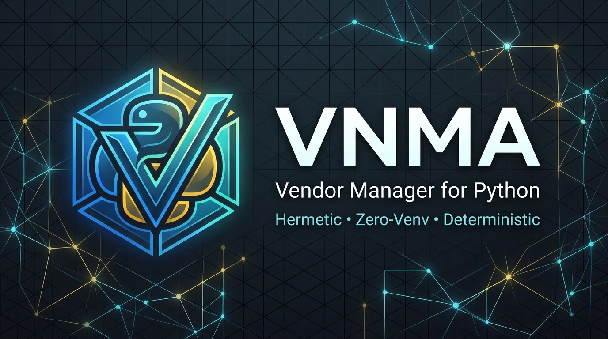

<p align="center">
  
</p>

<p align="center">
  <a href="https://pypi.org/project/vnma/"></a>
  <a href="https://pypi.org/project/vnma/"></a>
  <a href="https://github.com/GrandKenzy/vnma/actions/workflows/tests.yml"></a>
  <a href="LICENSE"></a>
</p>

# VNMA (Vendor Manager)

> **Status:** Beta (v0.3.0)  
> **Platform Support:** CPython 3.11, 3.12, 3.13, 3.14 (Tested on Windows and Linux)

`vnma` is a dependency and vendoring manager for Python projects. It installs and manages dependencies inside a local project directory (`vendor/` or `vendor_vnma/`) instead of creating full Python virtual environments (`venv`).

---

## What VNMA Does (and What It Doesn't)

### What it does:
* **Installs packages locally:** Downloads, verifies, and unpacks wheels directly into `vendor/`.
* **Runtime path isolation:** Cleans `sys.path` so your application loads third-party libraries strictly from `vendor/`, ignoring global or user `site-packages`.
* **Automatic DLL registration (Windows):** Automatically calls `os.add_dll_directory()` for folders containing native binaries (e.g., SDL2, C extensions), preventing import errors.
* **Transactional operations:** Installations and updates are staged in a private directory and committed atomically; if an install fails or crashes, previous state is restored via a recovery journal.
* **Transitive dependency resolution:** Resolves dependencies and version constraints with bounded backtracking and PEP 508 marker evaluation.
* **Live development links (`vnma link`):** Connects local libraries in development without copying files, keeping dependencies synchronized.
* **IDE configuration:** Configures `extraPaths` in VS Code (`.vscode/settings.json`) and `PYTHONPATH` in PyCharm (`.env`, `.idea/*.iml`).

### What it doesn't do:
* **It does not virtualize the Python executable:** It uses your installed Python interpreter and standard library directly.
* **It cannot load multiple incompatible versions of the same library simultaneously:** Python's runtime has a single global `sys.modules`. Conflicting version requirements are rejected at resolution time.

---

## Step-by-Step Guide

### Step 1: Install VNMA

Install `vnma` using `pip`:

```bash
pip install vnma
```

Or install in editable mode from source:

```bash
git clone https://github.com/GrandKenzy/vnma.git
cd vnma
pip install -e .
```

Verify the installation:

```bash
vnma --help
```

---

### Step 2: Initialize Your Project

Navigate to your project folder and run:

```bash
cd my_project
vnma init
```

This command creates:
1. `vnma.toml`: Declarative manifest for your project and dependencies.
2. `vendor/`: Directory for vendored packages.
3. `vendor/__bootstrap__.py` & `vendor/__init__.py`: Runtime loader and path sanitizer.
4. `.gitignore` entries: Ignores vendored packages in Git.
5. IDE settings: Preconfigures VS Code (`.vscode/settings.json`) and PyCharm (`.env`).
6. `vnma.lock`: Lockfile for reproducible installs.

---

### Step 3: Install Packages

#### From PyPI:
```bash
# Latest compatible version:
vnma install requests

# Pinned version:
vnma install colorama==0.4.6

# Multiple packages:
vnma install flask pytest
```

#### From a local directory:
```bash
vnma install ../shared-library
```

#### From a Git repository:
```bash
vnma install git+https://github.com/psf/requests.git@main
```

---

### Step 4: Run Your Code

You have two ways to execute your code with vendored packages:

#### Option A: Using the CLI (Recommended)
```bash
vnma run main.py
```
`vnma run` sets `PYTHONPATH` to your vendor directory and disables user-site packages automatically.

#### Option B: Direct Python execution
Add this import at the very top of your entry script (`main.py`):
```python
import vendor.__bootstrap__
import requests

response = requests.get("https://httpbin.org/get")
print(response.status_code)
```
Then run normally with your system Python:
```bash
python main.py
```

---

### Step 5: Link Local Libraries for Development (`vnma link`)

When actively developing an internal library alongside an app, avoid re-installing wheels after every change:

```bash
vnma link ../my-library
```

* **Zero-copy:** Does not copy files; imports live directly from the library's source directory.
* **Auto-dependency resolution:** Reads the library's dependencies and installs them into `vendor/`.
* **To unlink:**
  ```bash
  vnma unlink my-library
  ```
* **To check and synchronize linked libraries:**
  ```bash
  vnma reload
  ```

---

### Step 6: Maintain and Clean Your Project

#### List installed packages:
```bash
vnma list
```

#### Update dependencies:
```bash
# Update all unpinned dependencies:
vnma update

# Update only PyPI packages:
vnma update --pip

# Update only Git repositories:
vnma update --git
```

#### Remove orphaned packages (packages no longer required):
```bash
# Preview what would be removed:
vnma prune --dry-run

# Remove unused packages:
vnma prune --yes
```

#### Run project tests:
```bash
# Automatically detects 'tests/' or 'test/' directory and runs with pytest (or unittest):
vnma test

# Run a specific test file or directory with custom flags:
vnma test tests/test_feature.py -v
```

#### Uninstall packages or clean vendor:
```bash
# Remove package from vendor/ (retains declaration in vnma.toml):
vnma uninstall requests

# Remove from vendor/ AND remove from vnma.toml:
vnma uninstall requests -d

# Clean vendor/ and lockfiles (always preserves vnma.toml by default):
vnma uninstall -y

# Clean vendor/ and lockfiles AND remove vnma.toml:
vnma uninstall -y --purge-config
```

#### Restore dependencies on another machine or in CI:
```bash
vnma install
```

---

## Configuration Reference

### `vnma.toml` (Project Level)

```toml
[project]
name = "my-app"
version = "1.0.0"

[dependencies]
requests = ">=2.31.0"
colorama = "==0.4.6"
local-tool = { path = "../local-tool" }

[tool.vnma]
vendor_dir = "vendor"
ide_integration = ["vscode", "pycharm"]
```

### `vnma_config.toml` (Optional Library Manifest)

If developing a library with native DLLs or specific exports, place a `vnma_config.toml` in its root:

```toml
[package]
name = "my-library"
package = "my_library"  # Python import name (import my_library)
version = "0.1.0"

[runtime]
dll_directories = ["my_library/libs"]
hermetic = true

[exports]
modules = ["my_library"]
entry_points = { my-tool = "my_library.cli:main" }
```

---

## Command Summary

| Command | Description |
| :--- | :--- |
| `vnma init` | Initialize VNMA in the current project. |
| `vnma install <pkg>` | Install package(s) from PyPI, local path, or Git. |
| `vnma install` | Restore all dependencies declared in `vnma.toml`. |
| `vnma run <script>` | Run a Python script using the vendored runtime. |
| `vnma test [target]` | Run project tests (auto-detects 'tests/' or 'test/') using pytest or unittest. |
| `vnma link <path>` | Link a local library in development (zero-copy live edits). |
| `vnma unlink <name>` | Unlink a previously linked local library. |
| `vnma reload` | Verify links, update dependencies, and auto-prune obsolete packages. |
| `vnma list` | Show all installed packages and their versions. |
| `vnma update` | Update unpinned dependencies to their latest compatible versions. |
| `vnma prune` | Remove unused packages that are no longer referenced in `vnma.toml`. |
| `vnma uninstall [pkg]` | Remove a package or clean `vendor/` (preserves `vnma.toml` by default). |
| `vnma sync-ide` | Reapply VS Code and PyCharm configuration files. |
| `vnma clean` | Safely remove vendor folders and lockfiles. |

---

## Documentation

Full documentation is available in the [`docs/`](docs/) directory:

* **Getting Started:** [docs/en/01-Use/01-getting-started.md](docs/en/01-Use/01-getting-started.md)
* **Dependency Management:** [docs/en/01-Use/02-dependency-management.md](docs/en/01-Use/02-dependency-management.md)
* **Configuration Specifications:** [docs/en/01-Use/03-configuration-specs.md](docs/en/01-Use/03-configuration-specs.md)
* **Runtime Execution Model:** [docs/en/01-Use/04-runtime-execution.md](docs/en/01-Use/04-runtime-execution.md)
* **IDE Integration:** [docs/en/01-Use/05-ide-integration.md](docs/en/01-Use/05-ide-integration.md)
* **Beta Status & Limitations:** [docs/en/02-Advice/01-beta-status.md](docs/en/02-Advice/01-beta-status.md)
* **Changelog:** [CHANGELOG.md](CHANGELOG.md)

---

## License

This software is released under a modified permissive license. See [LICENSE](LICENSE) for terms.
