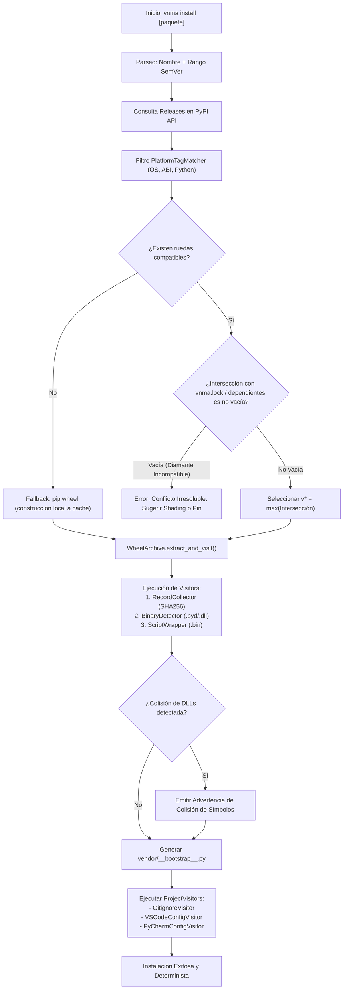

# 📐 Análisis Matemático y Arquitectónico de Conflictos en Vendoring para Python (`vnma`)

---

## 1. Formalización del Modelo de Resolución de Módulos

Para comprender por qué surgen conflictos en Python y cómo se diferencian de entornos como Node.js (npm), definimos formalmente el sistema de importación en tiempo de ejecución.

### 1.1. Topología del Espacio de Nombres en Python
Sea $\Sigma$ el conjunto de todos los identificadores válidos de módulos (cadenas como `"urllib3"`, `"pygame"`, etc.), y sea $\mathcal{M}$ el conjunto de instancias de módulos instanciadas en la memoria del proceso.

El entorno de ejecución de CPython mantiene un mapeo global implementado como un diccionario plano (`sys.modules`):
$$\mathcal{S}_{\text{py}}: \Sigma \longrightarrow \mathcal{M}$$

**Propiedad Fundamental:** $\mathcal{S}_{\text{py}}$ es una función univaluada (biyectiva localmente respecto al símbolo importado).  
$$\forall \sigma \in \Sigma, \quad |\mathcal{S}_{\text{py}}(\sigma)| \le 1$$

Esto implica que en un mismo proceso de Python no pueden coexistir dos módulos que respondan al mismo identificador $\sigma$, independientemente del directorio en el que residan en el disco.

### 1.2. Contraste con el Modelo Jerárquico Relativo (Node.js / npm)
En contraste, la función de resolución de Node.js toma en cuenta el contexto de la ruta del archivo que realiza la invocación ($\mathcal{P}_{\text{caller}} \subset \text{Rutas}$):
$$\mathcal{S}_{\text{node}}: \mathcal{P}_{\text{caller}} \times \Sigma \longrightarrow \mathcal{M}$$

Dado que el dominio incluye $\mathcal{P}_{\text{caller}}$, es posible tener:
$$\mathcal{S}_{\text{node}}(p_1, \sigma) = m_1 \quad \land \quad \mathcal{S}_{\text{node}}(p_2, \sigma) = m_2 \quad \text{con } m_1 \neq m_2$$

> **Conclusión Matemática 1:** En Python estándar es estructuralmente imposible instanciar dos versiones distintas de la misma librería bajo el mismo identificador dentro del mismo proceso sin alterar $\mathcal{S}_{\text{py}}$ o reescribir $\Sigma$.

---

## 2. El Problema del Diamante como un Problema de Satisfacibilidad (SAT / Álgebra de Intervalos)

### 2.1. Definición del Espacio de Versiones
Definimos el espacio de versiones $\mathbb{V} \subset \mathbb{N} \times \mathbb{N} \times \mathbb{N}$ bajo el estándar SemVer:
$$v = (\text{major}, \text{minor}, \text{patch}) \in \mathbb{V}$$
Dotado de un orden lexicográfico estricto total $\le_{\mathbb{V}}$:
$$v_a \le_{\mathbb{V}} v_b \iff (a_1 < b_1) \lor (a_1 = b_1 \land a_2 < b_2) \lor (a_1 = b_1 \land a_2 = b_2 \land a_3 \le b_3)$$

### 2.2. Restricciones de Dependencias
Sea un grafo dirigido acíclico de dependencias $G = (V_G, E_G)$, donde cada nodo representa un paquete y cada arista dirigida $(A, B) \in E_G$ representa que el paquete $A$ depende del paquete $B$.

Cada arista $e_{AB}$ impone una restricción de intervalo o predicado booleano de compatibilidad $\phi_{AB}: \mathbb{V}_B \to \{0, 1\}$, definiendo el subconjunto de versiones admisibles:
$$\mathbb{I}_{AB} = \{ v \in \mathbb{V}_B \mid \phi_{AB}(v) = 1 \} \subseteq \mathbb{V}_B$$

### 2.3. Condición de Satisfacibilidad en Vendoring Plano
En un vendoring de carpeta única (`vendor/`), si el paquete $C$ es requerido por $k$ dependientes $D_1, D_2, \dots, D_k$, la condición necesaria y suficiente para que el árbol sea realizable sin reescritura es:

$$\mathbb{I}_{\text{res}}(C) = \bigcap_{i=1}^{k} \mathbb{I}_{D_i C} \neq \emptyset$$

Si $\mathbb{I}_{\text{res}}(C) = \emptyset$, el sistema entra en un **Conflicto de Diamante Incompatible**.

```
                       [ Raíz del Proyecto ]
                           /           \
                 [ Paquete A ]       [ Paquete B ]
                       \               /
                 I_AC = [1.0, 2.0)   I_BC = [2.0, 3.0)
                         \           /
                       [ Paquete C ]
                 I_AC ∩ I_BC = ∅  ===> ¡CONFLICTO!
```

### 2.4. Función Objetivo de Resolución de `vnma`
Cuando $\mathbb{I}_{\text{res}}(C) \neq \emptyset$, `vnma` formula la selección como un problema de optimización determinista:
$$v^*(C) = \max_{\le_{\mathbb{V}}} \left( \mathbb{I}_{\text{res}}(C) \cap \mathbb{V}_{\text{PyPI}}(C) \cap \mathbb{V}_{\text{PlatformCompat}} \right)$$

---

## 3. Estrategias de Mitigación Matemática en `vnma`

Para abordar los casos donde $\mathbb{I}_{\text{res}}(C) = \emptyset$ o donde existen colisiones en el espacio global, `vnma` aplica las siguientes formulaciones:

### 3.1. Shading / Homomorfismo de AST (Reescritura de Símbolos)

Para que dos versiones incompatibles $C_{v_1}$ y $C_{v_2}$ coexistan en memoria, debemos modificar el dominio de identificadores $\Sigma$ para inducir una partición disjunta.

Definimos una transformación homomórfica de código $\mathcal{T}_k: \text{AST} \to \text{AST}'$:
$$\sigma \mapsto \sigma' = \text{prefix}_k \mathbin{\Vert} \sigma$$
Ejemplo:
$$\text{"urllib3"} \mapsto \text{"_vnma_shaded.v1.urllib3"}$$

Al transformar el AST de $A$, la consulta a `sys.modules` pasa a ser:
$$\mathcal{S}_{\text{py}}(\text{"_vnma_shaded.v1.urllib3"}) = m_{C_1}$$
$$\mathcal{S}_{\text{py}}(\text{"urllib3"}) = m_{C_2}$$

$$\mathcal{S}_{\text{py}}(\sigma_1') \cap \mathcal{S}_{\text{py}}(\sigma_2) = \emptyset \implies \text{Cero colisión en memoria}$$

#### Límite Teórico del Shading:
El shading es trivial para código interpretado en Python puro ($\mathcal{T}_k$ opera sobre el árbol sintáctico).  
Sin embargo, para binarios compilados ($P_{\text{binary}} \in \{.pyd, .so\}$), el punto de entrada exportado en la tabla de símbolos del binario (`PyInit_<nombre>`) está fijado en tiempo de compilación. Por lo tanto, dos binarios con el mismo nombre base no pueden renombrarse en caliente sin bin-patching de la tabla PE export `/EXPORT:PyInit_...`.

---

## 4. Colisión en el Espacio de Direcciones de Bibliotecas Dinámicas (DLL Hell)

### 4.1. Formalización del Enlazador Dinámico del SO
Sea $\mathcal{L}_{\text{OS}}$ el cargador de bibliotecas dinámicas del sistema operativo (Windows PE Loader / Linux `ld.so`).

$$\mathcal{L}_{\text{OS}}: \text{Filename} \longrightarrow \text{BaseAddress} \in \mathbb{R}^+$$

Cuando una extensión `.pyd` ejecuta una llamada a una función exportada por una DLL compartida (ej. `SDL2.dll` o `libopenblas.dll`), el sistema operativo mantiene una tabla de módulos cargados por proceso:
$$\text{LoadedModules}: \text{Name} \to \text{ModuleHandle}$$

Si el paquete $A$ carga `vendor/lib_a/zlib.dll` (v1.2.8) y posteriormente el paquete $B$ solicita `vendor/lib_b/zlib.dll` (v1.3.1), el enlazador verifica la tabla:
$$\text{Name} \in \text{LoadedModules} \implies \text{Reutiliza Address de v1.2.8}$$

Si la interfaz binaria (ABI) difiere:
$$\exists \text{ offset } \delta \mid \text{Signature}_{v_1}(\delta) \neq \text{Signature}_{v_2}(\delta) \implies \text{STATUS\_ACCESS\_VIOLATION (Crash)}$$

### 4.2. Mitigación en `vnma` mediante Aislamiento de DLL Directories
En Windows con Python 3.8+, `os.add_dll_directory(path)` utiliza internamente la API Win32 `AddDllDirectory`.

`vnma` modela el registro de DLLs no como una unión ciega, sino como un grafo de dependencias de rutas:
1. `BinaryDetectorVisitor` calcula la función hash:
   $$H: \text{DLL\_File} \longrightarrow \text{SHA256}$$
2. Si detecta $\text{Name}(D_1) = \text{Name}(D_2) \land H(D_1) \neq H(D_2)$:
   * Emite una alerta de colisión crítica $\text{CollisionWarning}(D_1, D_2)$.
   * Reorganiza el orden de búsqueda o aisla las carpetas según el orden topológico de carga.

---

## 5. Teorema de Hermeticidad del Entorno de Ejecución

### 5.1. Definición del Vector de Búsqueda
Definimos el vector de búsqueda de módulos $\vec{P} = (p_0, p_1, \dots, p_n) \in \text{Paths}^n$, el cual corresponde a `sys.path`.

Sea $\text{Univ} = \text{VendorPaths} \cup \text{StdlibPaths} \cup \text{GlobalSitePackages}$.

Un entorno se define como **Estrictamente Hermético** si:
$$\forall p \in \vec{P}, \quad p \notin \text{GlobalSitePackages}$$

### 5.2. El Operador de Proyección Hermética $\mathbf{P}_{\text{hermetic}}$
En [`vnma/runtime/bootstrap.py`](file:///c:/Users/Kentucky/Desktop/PROYECTOS%20_%20PYTHON/vnma/vnma/runtime/bootstrap.py), implementamos el operador:
$$\mathbf{P}_{\text{hermetic}}(\vec{P}) = (p_{\text{vendor}}) \mathbin{\Vert} \left( p \in \vec{P} \mid p \in \text{StdlibPaths} \right)$$

Esto garantiza que:
$$\text{DependenciasResueltas}(Proyecto) \subseteq \text{Archivos}(\text{vendor/})$$
Eliminando por completo el síndrome de *"funciona en mi máquina porque tengo la librería instalada globalmente"*.

---

## 6. Algoritmo General de Decisión para `vnma install`



---

## 7. Resumen de Complejidad Computacional

| Componente | Algoritmo | Complejidad Temporal | Complejidad Espacial |
| :--- | :--- | :--- | :--- |
| **Resolución de Tags** | Búsqueda en tabla hash priorizada | $O(T_{\text{wheel}} \cdot T_{\text{host}})$ donde $T \le 15 \implies O(1)$ | $O(1)$ |
| **Detección de Diamante** | Intersección de intervalos SemVer | $O(N \cdot \log N)$ para $N$ paquetes | $O(N)$ |
| **Extracción y Visitors** | Recorrido lineal ZIP con hashing SHA256 | $O(B)$ donde $B$ es el tamaño total en bytes | $O(\text{chunk}) = O(64\text{ KB})$ |
| **Poda de Huérfanos (`uninstall`)** | Ascenso en árbol de directorios | $O(D \cdot h)$ ($D$ dirs, $h$ altura máxima) | $O(h)$ |
